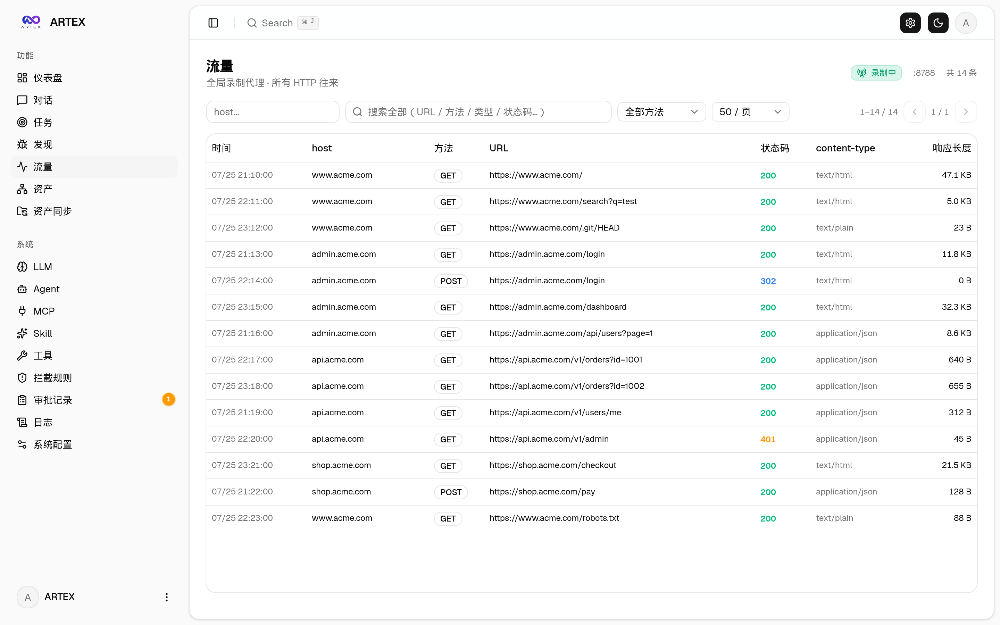

<div align="center">

# Argus

### 本地优先的授权安全研究与 SRC 验证工作台

面向个人研究者与安全团队的本地桌面应用：范围控制、资产分析、浏览器取证、证据质量、发现关联和报告生成全部可追踪。

[](https://github.com/shuhuNB515/Argus/releases) [](https://github.com/shuhuNB515/Argus/actions) [](LICENSE)

[下载 Argus](https://github.com/shuhuNB515/Argus/releases) · [英文文档](README.en.md) · [安全报告](SECURITY.md)

</div>


Argus 是一个本地运行的授权安全研究与 SRC 验证工作台。它把目标范围、资产、工具调用、浏览器观察、证据、发现和报告放在同一条可追踪链路中，适合个人安全研究、内部测试和经过授权的漏洞验证。

> 安全边界：只能测试你拥有或明确获得书面授权的目标。不要对第三方系统进行未授权扫描、越权、破坏性测试、拒绝服务、支付操作、账号操作或权限变更。

## 主要功能

- **SRC 会话与范围控制**：保存 Target、Test Range、协议和端口范围；网络工具执行前统一检查授权范围，超出范围时拒绝执行并记录原因。
- **资产与侦察**：登记域名、URL、服务和观察结果，支持被动信息整理、指纹识别、资产分析和技能路由。
- **证据优先的发现流程**：扫描器、技能或浏览器观察先记录为 potential issue；只有完成验证、影响证据、来源记录和质量门禁后，才允许进入 confirmed finding。
- **只读浏览器取证**：记录页面状态、截图、请求观察、页面差异和证据来源；截图本身不会自动升级为漏洞。
- **发现关联与报告**：支持去重、冲突、过期、需要重新验证等状态，并生成 Markdown、HTML、PDF 报告。
- **Agent 执行链**：原生工具调用、工具注册、执行结果、失败恢复、任务图和实时工作流事件可追踪。
- **AOCI 架构索引**：运行时加载项目架构索引，为新会话提供快速、可验证的上下文。
- **模型配置**：支持 OpenAI-compatible API 地址、模型、备用配置和连接测试。API Key 只保存在本机运行数据中。
- **中英文界面**：默认中文，同时提供英文界面和英文文档；项目不再提供韩语、西班牙语或日语界面。

## 适合谁使用

Argus 适合在本机完成授权范围内的安全研究、SRC 漏洞验证、内部应用测试和证据整理。它不是云端代扫平台，也不会因为发现一个可疑页面、响应头或截图就自动把结果标记为漏洞。

## 工作方式

| 阶段 | Argus 会记录什么 | 结果状态 |
| --- | --- | --- |
| 范围确认 | Target、Test Range、协议、端口和授权边界 | 超出范围立即拒绝 |
| 资产与侦察 | 域名、URL、服务、指纹和页面观察 | 形成可追踪资产 |
| 发现与验证 | 工具调用、请求、响应、浏览器状态和验证步骤 | 先记录为潜在问题 |
| 证据与质量 | 截图、页面状态、来源、影响和去重关系 | 通过质量门禁后升级 |
| 报告交付 | Finding、Evidence Bundle、Markdown、HTML、PDF | Draft 或 confirmed |

## 界面预览

| 会话与浏览器取证 | 任务图与执行状态 |
| --- | --- |
|  |  |

| 资产与流量 | 发现与证据 |
| --- | --- |
|  |  |

## 下载

从 [GitHub Releases](https://github.com/shuhuNB515/Argus/releases) 下载最新版本。安装包名称中的 `0.1` 是 Argus 应用版本，不是 CPU 架构。

| 系统 | 电脑类型 | 文件 |
| --- | --- | --- |
| macOS | Apple Silicon，包括 M1/M2/M3/M4/M5 | `argus-*-darwin-arm64.dmg` |
| macOS | Intel | `argus-*-darwin-amd64.dmg` |
| Windows | Intel/AMD x86-64 | `argus-*-windows-amd64-setup.exe` |
| Linux | Intel/AMD x86-64 | `argus-*-linux-amd64.zip` |
| Linux | ARM64 | `argus-*-linux-arm64.zip` |

`amd64` 就是常说的 x86-64。Apple Silicon Mac 必须选择 `darwin-arm64`，不要选择 `darwin-amd64`，否则可能出现 `Bad CPU type in executable`。Windows x86-64 电脑选择 Windows amd64 安装包；Linux 包是便携压缩包，不需要 Docker。

发布页同时提供 `SHA256SUMS`。下载后可用以下方式校验：

```bash
shasum -a 256 -c SHA256SUMS
```

## 安装与首次启动

### macOS

1. 下载匹配芯片的 `.dmg`。
2. 双击 DMG，将 `Argus.app` 拖入“应用程序”。
3. 从“应用程序”或桌面快捷方式启动 Argus。
4. 应用启动后会打开本地工作台；如果浏览器没有自动打开，请访问 <http://127.0.0.1:8787>。

### Windows

1. 下载 Windows x86-64 的 `setup.exe`。
2. 运行安装程序并按提示完成安装。
3. 安装程序会创建开始菜单和桌面快捷方式。
4. 点击 Argus 快捷方式即可启动；不需要 Docker 或手动启动脚本。

### Linux

1. 下载 `linux-amd64` 或 `linux-arm64` 压缩包并解压。
2. 进入解压目录，执行 `./start.sh`。
3. 浏览器访问 <http://127.0.0.1:8787>。

Linux 当前提供便携 ZIP；它不修改系统包管理器，也不要求安装 PostgreSQL 或 Docker。需要桌面快捷方式时，可以把 `start.sh` 添加到发行版的应用启动器中。

## 数据库与数据目录

Argus 面向普通用户提供自包含运行方式：不需要用户安装 Docker、创建 PostgreSQL、填写数据库密码或手动配置 DSN。应用会在用户数据目录准备并复用本地运行数据。

- macOS：`~/Library/Application Support/Argus`
- Linux：`~/.local/share/Argus`
- Windows：`%LOCALAPPDATA%\\Argus`

任务、会话、资产、流量、证据和报告都保存在本机数据目录。卸载应用前如需保留数据，请先备份该目录。开发者或已有部署可以显式设置 `ARGUS_PG_DSN` 使用外部 PostgreSQL；普通用户不需要设置它。

## 模型配置

首次打开后，在 Argus 的模型设置中填写你自己的 OpenAI-compatible 服务地址、模型名称和 API Key，然后使用“测试连接”确认配置。

- API Key 不会写入 GitHub、安装包或公开报告。
- 不要把 API Key 放进 README、Issue、聊天截图或提交记录。
- 余额不足、Key 无效、限流和供应商错误会显示为可解释的模型错误，不会伪造安全发现。

## 一次授权 SRC 测试的建议流程

1. 创建 SRC 会话并填写 Target。
2. 明确填写 Test Range、允许的协议和端口。
3. 先进行 Recon、Fingerprint 和 Asset Analysis。
4. 只使用范围内的非破坏性 Discovery、Validation 和 Impact 检查。
5. 保存浏览器页面状态、截图和其他 Evidence。
6. 运行 Evidence Quality、Finding Correlation 和 Report Quality Gate。
7. 生成 Draft 报告；没有充分证据时，应保留为 0 confirmed findings 或 informational observation。

## 从源码运行

桌面用户不需要执行本节。开发者可以使用本地模式：

```bash
git clone https://github.com/shuhuNB515/Argus.git
cd Argus
cp .env.example .env
./dev.sh
```

开发工作台默认地址为 <http://127.0.0.1:8788>。Docker Compose 仅用于开发环境或已有部署，不是桌面安装包的前置条件。

## 从源码构建

需要 Go、Node.js/npm、zip 和 rsync：

```bash
cd web
npm ci
npm run build:static
cd ..
./build.sh --release --no-compress
```

构建结果位于 `dist/`，包括 Linux、macOS、Windows 的对应架构包，并生成 `SHA256SUMS`。macOS DMG 和 Windows 安装 EXE 需要在相应系统或 GitHub Actions runner 上构建；Linux 构建可以在 Linux/CI 环境中完成。

## 开发验证

```bash
go test ./...
cd web
npx tsc --noEmit
npm run check:i18n
npm run build:static
cd ..
git diff --check
```

## 许可证与安全报告

项目使用 AGPL-3.0。请阅读 [LICENSE](LICENSE)、[SECURITY.md](SECURITY.md) 和 [CODE_OF_CONDUCT.md](CODE_OF_CONDUCT.md)。安全问题不要公开发布复现细节，应按 [SECURITY.md](SECURITY.md) 的私密流程联系维护者。

## English

See [README.en.md](README.en.md) for the complete English documentation.
