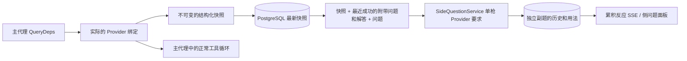

# ARGUS `/btw` 附带问题

中文 · [中文](README.zh.md)

一般聊天, 工作的 MainAgent, 而现在的工作就直接展开了 Worker 支持与主要对话分开的次要问题。. 在主输入窗口中 `/btw 问题` 输入 提交附带问题。, 没有内容 `/btw` 只需输入或 "附带问题" 单击按钮可打开上一个副题历史记录. 在桌面上，它是一个宽度可调的侧边栏。, 手机上的抽屉(Drawer)显示为.

附带问题响应是根据提交问题时的座席上下文快照生成的。, 流媒体显示·其他问题·停止·支持清空. 关闭面板，刷新页面，或者 SSE 即使连接丢失，模型请求也不会取消. 停止仅影响当前正在进行的一侧问题。, 清除会取消附带问题并删除附带问题历史记录，但完整保留文本上下文快照。.

> 本文件为中文原件(`README.zh.md`)被翻译成中文。. 上游(upstream) 保留原始文件，以便可以轻松比较存储库中的更改。.

## 实施范围

Go, norma v0.3.7, Next.js, 和现有的 Markdown · ResizablePanel · Drawer · AlertDialog 按原样使用组件, norma 我没有修改源代码或为附带问题添加任何新的依赖项。. Planner, 从其他工作结转的 Worker, 工具子任务的提升超出了此处的范围.

- `capture.go` 是 `Options.Deps.CallModel` · `CallModelSync` 仅标记为主循环请求. Provider 装饰器位于各个模型内部, 换句话说，路由池从外部选择模型并进入下一阶段。, 记录实际选择的型号. 压缩和摘要请求不会覆盖快照.
- 请求何时发起, 当模型完成响应时, 当执行达到结束状态时会发出快照。. 不要发出正在生成的半响应. 工具调用是 norma 的 `MessagesForAPI` 通过维持伴侣, 在下一个主模型请求或执行结束时，工具结果将被纳入快照中。. 如果流中断，则保持先前的有效边界.
- 快照是 JSON 具有深层复制的结构化消息, 系统提示, 工具定义, 保留创建参数. 模型推理不持有快照锁或数据库事务.
- `SideQuestionService` 是个人的 Provider 打电话. 如有必要，首先创建附带问题的摘要。, 仅当上下文首先超出限制并且尚未发出任何文本或工具调用时，才会减少最终响应并重试一次。. 无需创建新的代理会话, 工具启动器·主要 transcript·活动流·不连接到任务图；, 甚至不经历工作模型转换链. 响应维护工具定义的原因是为了确保与现有结构化工具上下文的兼容性。, 我们不提供摘要请求工具. 新返回的工具调用没有执行路径.
- 每个父会话仅运行一个请求。, 每个服务进程最多四个。, 一次请求的时间限制为 120秒. 附带问题在服务生命周期下使用独立的取消上下文.
- 附带问题请求保留模型设置参考和非敏感识别信息的摘要。, 凭证是在请求时从现有设置中提取的. 设置被删除或模型·协议·当地址等识别字段发生变化时, 首先，它要求您运行主代理来更新快照。. 测试不会改变产品基础模型.

## 延续与恢复

`db/schema.sql` 银 `side_question_sessions` 哇 `side_question_requests` 自动创建表. 上表是父资源, 最新快照, 运行数, 版本, 保存一个干净的版本并, 后桌正在提问, 累积反应, 状态, 型号, 快照时间, 用途, 活动编号, Save the page order number.

父会话密钥是 conversation ID 或, task ID 哇 exploration ID 哇 intent ID 一起写吧. Worker 不写入可重用的执行槽名称.

通过将快照合并到父会话中来记录快照。 250每毫秒反射一次, 数据库 `(run_id, version)` 比较以防止旧版本覆盖新版本。. 在提交附带问题之前再次保存所选快照。. 如果保存成功，则释放内存中的大快照并, 如果失败，则会留下尚未记录的版本. 累积响应内容取决于流事件到达时的情况。 250每毫秒记录一次, 在退出状态下立即保存，但如果发生数据库错误，则重试有限次数。.

服务开始前 `running` 仍处于状态的请求 `interrupted` 将其标记为, 一些已存储在数据库中的响应和使用情况保持不变。, 不会自动重新运行请求. 最近成功保存的上下文可以直接用于下一个问题。. 如果旧会话没有快照，则需要先运行主代理，然后, UI 不从活动历史记录中重新创建上下文.

清除操作会引发干净版本并删除请求。, 防止条件更新再次记录迟到的回调. 物理删除父资源时，将其留给外键级联。, Worker 逻辑删除时，同一事务内的辅助数据也会被删除，并且稍后到达的快照将被拒绝。. 归档工作时，首先阻止新请求。, 等待主流程停止, 取消副题，等待数据库反映. 存档格式为 v3 和, 没有副题表 v1 · v2 它还兼容.

保存所有记录, 基于连续光标的每页最大数量 20归还枪. 模型请求最多包含最近成功的问题和答案文本。 20将包裹寄回, 将金额限制在代币预算内。, 早于该日期的问题和答案将作为单独的滚动摘要进行管理。. 如果正文上下文超出您的预算，请仅总结附带问题副本的较旧部分。, 最近的结构化工具调用及其结果被遗忘. 摘要和准备进度以及使用都是同时运行的附带问题。·取消·120在第二时限规则内集合. 欲了解更多信息 [背景预算和开源资源(CONTEXT_BUDGET.md)](CONTEXT_BUDGET.md) 请参考.

## HTTP 合同

以下路径 `{parent}` 写作与, 按原样遵循现有身份验证和资源验证。.

- `/api/conversations/{id}`
- `/api/tasks/{id}/chat`
- `/api/tasks/{id}/intents/{iid}`

每个请求的返回和操作如下：.

- `GET {parent}/side-questions?before={ordinal}` 是 `items` 按最新排序并返回, 运行状态 进行中(`current`), 快照元信息(`snapshot`), 下一个光标(`next_cursor`)返回与. 光标 0 这意味着这是最新的页面或没有下一页。.
- `POST {parent}/side-questions` 是 `{ "question": "…", "client_request_id": "UUID" }` 的形式 JSON 收到. 如果是新的请求 202 返回请求对象, ID 如果问题与 200 返回到.
- `DELETE {parent}/side-questions` 取消并清空当前家长会议的附带问题和答案。.
- `GET /api/side-questions/{requestID}/events` 是 `snapshot` SSE 发送事件, `id` 是递增顺序 `data` 是累计请求对象总数. 当排空发生时 `cleared` 发送.
- `POST /api/side-questions/{requestID}/cancel` 明确取消请求, 记录退出状态或 SSE 您可以在以下位置阅读：.

问题达 4000给你. 没有快照或, 模型设置已更改, 正在处理同一个父会话，或者, 幂等的 ID 如果崩溃了 409 返回, 如果达到总并发执行限制， 429 回报. SSE 由于连接每次都会先发送累积的状态，, 不依赖于客户端之前收到的文本片段. 前端请求 ID 按 和 的顺序将答案组合起来, 替换或释放父会话时丢弃以前的回调.

## 验证和参考资料

自动化检查, 使用真实模型, 已知的限制是 [VALIDATION.md](VALIDATION.md) 我把它组织在.

如何请求独立 [Grok CLI 的 side-question.ts(固定提交)](https://github.com/superagent-ai/grok-cli/blob/fb97af83f06dca873281d60168430f06c8de6324/src/utils/side-question.ts) 到, 执行隔离是 [OpenCode(固定提交)](https://github.com/anomalyco/opencode/tree/b3f1a96c6dd7adeb28b36dd11add1998fc84d67b) 我提到. ARGUS 在上下文中 norma 它使用结构化消息, 我没有使用前端日志中连接文本的方法。.
